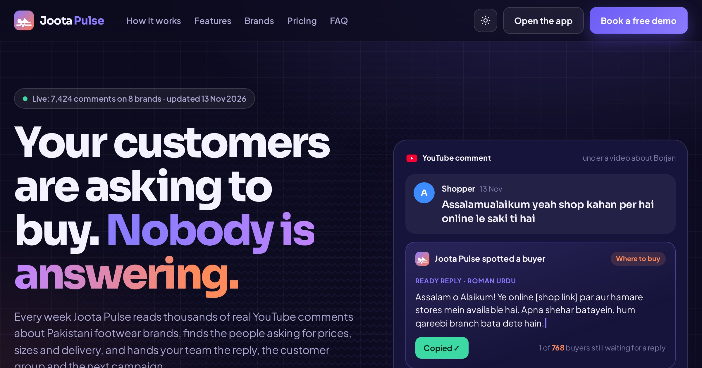

# Joota Pulse

**Audience intelligence for Pakistani footwear brands.** Live app: **https://usamahanif349.github.io/joota-pulse/**

Joota Pulse reads 6,724 real public YouTube comments about Borjan, Servis, Ndure, Stylo, Metro, Hush Puppies, Insignia and ECS, and shows a brand's marketing team:

- **Missed sales:** buyers who asked about price, stock or delivery and never got a reply (an estimate you can adjust)
- **Leads inbox:** every waiting buyer, with a ready reply in Roman Urdu or English and a copy button
- **Your customers:** 11 customer groups and what to do for each
- **Post this, not that:** content that starts conversations, plus a creator leaderboard
- **Competitors:** all 8 brands side by side
- **Campaign ideas:** ready-to-run campaigns with ad copy
- **Client report:** a one-page snapshot to download as PDF

A static web app (HTML, CSS, JavaScript) hosted free on GitHub Pages. **The data updates itself every week:** a GitHub Action (`.github/workflows/refresh.yml`) collects fresh comments with the YouTube Data API, re-runs the engine and republishes the site; `state/` remembers known videos, when each comment was first seen (for "new" leads) and the history behind the trend line. The analysis behind it (data collection, multilingual AI embeddings, clustering, anomaly detection, Spark benchmark) lives in **[pk-footwear-audience-engine](https://github.com/usamahanif349/pk-footwear-audience-engine)**, which exports `data.json` for this app.

Project 3 of the Big Data Analytics course, UMT Lahore · Usama Hanif.
Data: public YouTube comments via the official YouTube Data API, collected 12 Nov 2026; commenter names removed. Sample replies and ad copy were written for a class project.
